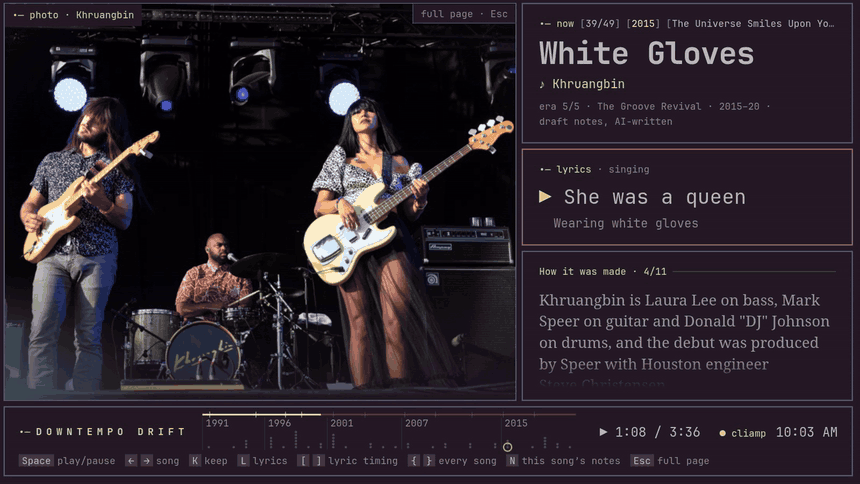
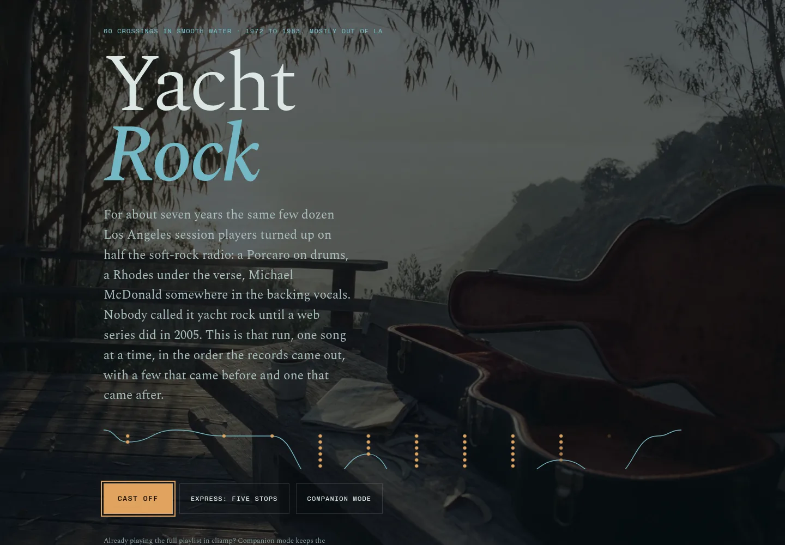
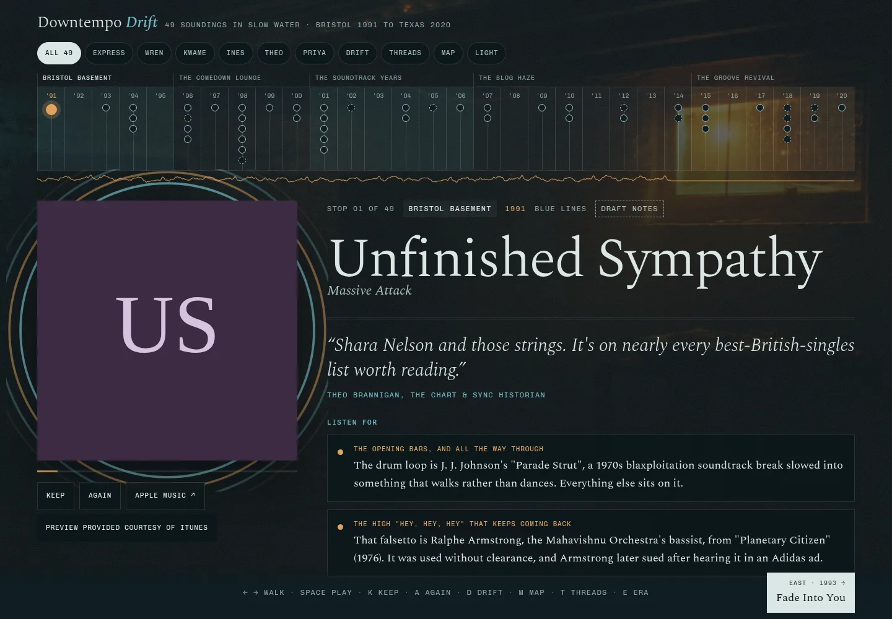

# Liner Notes



Remember reading the sleeve while the record played? Me neither, but I like the idea of it. Liner Notes does that for whatever you're streaming. Put it on a second monitor, a tablet or a phone next to [cliamp](https://github.com/bjarneo/cliamp) and it reads along with the song.

The clip above is the stage, the lean-back view. cliamp is playing "White Gloves" and the page keeps time with it: each lyric line lights up as it's sung, the band photo drifts in parallax off a depth map, and the right column works through how the record was made (a barn on the Speer family's land in Burton, Texas, where they had to clear the bees out first). The strip along the bottom is the whole journey, 49 songs from Bristol in 1991 to Texas in 2020, with a marker on song 39. Skip, shuffle or jump around in cliamp and the page follows within half a second. On Omarchy it takes its colours and font from your theme.

On my own machine the stage goes further. When the music video is on disk it plays muted on the stage, synced under cliamp's audio after a measured correction for the speakers' latency (the sync tests land at a median of 6 or 7 ms). Lyrics are retimed against the exact upload cliamp is playing, so a video edit that starts 37 seconds into the album cut still lines up. None of that leaves the machine, for reasons further down.

| The journey page | Every song, with what to listen for |
|---|---|
|  |  |

Away from the stage, each journey is a page you can read on its own: an essay per era over a picture, a chart of every song by year, and for each song what to listen for (the drum loop under "Unfinished Sympathy" is J. J. Johnson's "Parade Strut", slowed down), how it was made, what was going on that year, threads to other songs on the list, and one record to chase next. A panel of five invented judges argued each list into shape, and their quotes and close calls are on the page. These two screenshots are the shareable build, which is why the covers are lettered squares.

It started as a page for one playlist, Downtempo Drift, and turned into a small engine for any playlist. Six journeys ship here:

- Downtempo Drift, 49 songs, Bristol 1991 to Texas 2020
- Sophisti-Pop, 42 songs, 1982 to 1990
- Yacht Rock, 60 songs, 1972 to 1983
- Yacht House, 15 house remixes of yacht rock records, each laid against the original it flips
- Rod Temperton, 20 songs by the man from Cleethorpes, Heatwave in 1976 to Anita Baker in 1986
- Soul Rap Covers, 35 rap records sung back as soul, Run-DMC in 1986 to Roddy Ricch in 2019

An AI model wrote every note in the bank, working from the sources listed in each file. All 203 songs are still drafts: nobody has checked them against their sources yet, and the page labels them "Draft notes". The band photo in the clip is by Alexander Kellner, from [Wikimedia Commons](https://commons.wikimedia.org/wiki/File:Khruangbin_am_Haldern_Pop_Festival_2019_-_09_-_Foto_Alexander_Kellner.jpg), CC BY-SA 4.0. The pictures behind the journey pages are AI-generated.

## What you need

- Python 3.11 or newer. The bridge and the page builder use only the standard library.
- [cliamp](https://github.com/bjarneo/cliamp) 2.0 or newer for the full experience (it speaks the V2 IPC this uses). Any MPRIS player on Linux works too, with less: no lyrics, no history, no jumping to a song.
- Optional: Pillow (`[media]`) to fetch covers and pictures; numpy, Pillow and onnxruntime (`[depth]`) for depth maps that move the stage pictures in parallax; numpy (`[remix]`) to measure remix tempos; the `anthropic` SDK plus an API key (`[generate]`) to write notes for your own playlists.

## Install

```sh
pipx install git+https://github.com/jampick/liner-notes
liner-notes doctor              # finds cliamp and its socket, Chromium, who has port 47391, what each journey can show
liner-notes service install     # the bridge as a systemd user service, restarted if it dies
```

`doctor` only looks. It prints one line per thing it checked and a table per journey: songs with notes, covers in the cache, songs with a video on disk (their own, or a stand-in), and songs with retimed lyrics. From a checkout, `pip install -e '.[dev]'` does the same plus the test tools.

## Daily use

```sh
liner-notes play drift          # or a playlist name: liner-notes play "Downtempo Drift"
```

This is what my Stream Deck keys run. It loads the playlist into cliamp (or starts cliamp with it), turns shuffle off and plays from the first song, then opens the journey's page in companion mode. On Hyprland the page goes full screen onto the workspace it was on last time (2 the first time) without taking focus, so a game on another workspace keeps it. A cold-started cliamp goes to workspace 3, also without taking focus. Pressing the key of the playlist that's already loaded leaves the music alone (a paused one picks up where it was) and only brings the page back. A playlist with no journey gets the live stage: title, artist, the cover if the cache has it, lyrics and the night so far.

If cliamp doesn't have a journey's playlist yet, `liner-notes add downtempo-drift` writes it into cliamp's playlists folder, in the order the page numbers the songs.

To bind a key, point it at `liner-notes play <name>`. A full playlist name always works. Short names are yours to set in `~/.config/liner-notes/config.toml` (none ship by default; `liner_notes/data/config.example.toml` has the whole file):

```toml
[keys]
drift = "Downtempo Drift"
yacht = "Yacht Rock"

[stage]
workspace = 2          # where the page opens the first time
cliamp_workspace = 3   # where a cold-started cliamp goes
```

Building pages, once per journey and again after you change one:

```sh
liner-notes media downtempo-drift      # covers and pictures into the cache (slow on purpose)
liner-notes build --all                # every journey and the live page, into ~/.local/share/liner-notes/dist
```

A build is written to a temp file and moved into place, so the page on screen is never half a file. A journey with a problem (a song missing from the bank, a stop outside every era) isn't written unless you add `--force`. Yacht House is the exception to "any machine": its stage is built from remix alignments and lyrics that aren't public, so it only builds where those files are.

Without the systemd unit, `liner-notes open` starts the bridge itself. On a tablet or phone on the same network, run `liner-notes serve --lan` and scan the QR code it prints. If you use Tailscale, `liner-notes serve --tailscale` serves HTTPS on your machine's ts.net name instead, which phones need to keep the screen awake.

## Offline mode

When YouTube stops answering (it flagged my IP twice), `liner-notes offline on` makes every key load the playlist's `<Name> (offline)` twin from cliamp's playlists folder when there is one, with the same page. `liner-notes offline off` goes back, and `liner-notes offline` says which it is. The switch is a file, `~/.local/state/liner-notes/offline`.

## Three layers

1. **Live, for any song.** What cliamp knows: title, artist, position, lyrics, the visualizer bands, tonight's history. Free and instant, even for songs nobody has written about.
2. **The song bank.** Notes per song in `liner_notes/shipped/songs/<artist>--<title>.json`, written once and reused by every journey that has the song. Every fact carries a source.
3. **Journeys.** A playlist with an order through the years, eras with an essay and a photograph, threads between songs, and optionally a panel: five invented judges with a lens each who argued the list into shape. The panel is fictional and the page says so.

## Your own playlists

```sh
liner-notes generate --from "Yacht Rock"                          # a saved cliamp playlist
liner-notes generate --provider navidrome --playlist 42           # any cliamp provider, read-only
liner-notes generate --from "Yacht Rock" --write --budget 5       # also write the songs the bank doesn't have
```

Without `--write` it costs nothing. It matches your tracks against the song bank, looks up release years on MusicBrainz, cuts eras at the widest gaps between years and builds a journey from what's already known. With `--write`, each missing song is one Claude API request with web search, using `liner_notes/prompts/SONG-BRIEF.md`. It must list its sources, and it stops before it can pass your budget. What you generate lives in `~/.local/share/liner-notes`, not in this repo.

## Players

The bridge reads now-playing through an adapter. Each one yields the same shape: title, artist, album, duration, a position and the time it was true, state, and whatever ids the player gives (YouTube id, Spotify id, file path, ISRC, MusicBrainz id).

| Adapter | How | Status |
|---|---|---|
| `cliamp` | V2 IPC on its Unix socket, with events, control, jump, lyrics, history and bands | works |
| `mpris` | D-Bus through `busctl`, any MPRIS player on Linux | works, tested against cliamp's MPRIS |
| `homeassistant` | a `media_player` over Home Assistant's WebSocket API (Sonos, Cast, AirPlay, Plex and more) | parser tested, not yet run against a live HA |
| `macos` | `media-control stream` from [ungive/media-control](https://github.com/ungive/media-control) | parser tested, not yet run on a Mac |
| `smtc` | Windows media controls through a small helper that prints JSON lines | contract and parser only |
| `lastfm` | a Last.fm user's now-playing scrobble, no position | parser tested |

`liner-notes serve` picks the first one it finds. `--player` picks one.

## Contributing a song

The bank grows by pull request. Copy an existing file in `liner_notes/shipped/songs/`, keep the shape in `liner_notes/schemas/song.schema.json`, and list a source for every fact. A new song starts with `"review": {"state": "draft"}`. Drafts show as "Draft notes" on the page. A maintainer reads it against its sources before it becomes `reviewed`. `liner-notes check` runs the same checks CI does.

The voice: a friend who has the records and has read the interviews. No em dashes, no "iconic", no "timeless". Specific names, studios, samples, chart positions, years. The full rules are in the song brief.

## Reviewing songs on your machine

`liner-notes review <song id> --by NAME` records your own review in a copy of the song under `~/.local/share/liner-notes/songs/`. It stays on your machine and never edits the shipped file. `liner-notes check` counts it apart from the shipped reviews ("12 reviewed by a person, plus 1 in your copies"), because it's your review, not a maintainer's. For now your own pages also stop marking that song as draft notes; the shipped song and everyone else's pages don't change. A maintainer's review only comes through a pull request.

The copy notes which shipped version it started from, so `liner-notes doctor` tells you when the shipped song has changed since. `liner-notes review <song id> --undo` puts it back to draft, and deletes the copy if you haven't changed anything else in it since it was made. `liner-notes drop <song id>` moves your copy aside to `~/.local/share/liner-notes/dropped/<date>/`, so you read the shipped song again and can still get yours back.

## What's public and what stays on your machine

Committed, because we wrote or made them: the code, the song notes and journey text, the panels, the year culture notes, and the era pictures (AI-generated, labelled as such).

Never committed, and never in a shareable page:

| What | Where |
|---|---|
| Retimed lyrics and remix alignments | `~/.local/share/liner-notes/lyrics/`, `.../remixes/` |
| Stand-in videos and culture clip ids | `~/.local/share/liner-notes/standins/`, `.../culture-videos/` |
| Built pages (they carry covers) | `~/.local/share/liner-notes/dist/` |
| Album covers, Wikipedia pictures, depth maps, video, audio | `~/.cache/liner-notes/` |
| The page's Chromium profile, its workspace, A/V latency, the offline switch | `~/.local/state/liner-notes/` |

Covers belong to the labels. Wikipedia pictures each have their licence recorded, and `media --public` drops the ones that aren't freely licensed. Lyrics are licensed text, and retimed ones are derived from it. The disk video is for personal use only: YouTube's developer policies don't allow separating a video from its audio, so the stage plays it muted under cliamp's audio and only on your machine. The pages never talk to YouTube.

`liner-notes build <slug> --public` makes a page you can send to someone: no covers, no video ids, the same notes. `liner-notes check --publish` fails if anything from the table turns up in the tree or in a public build, and CI runs it on every push.

`liner-notes migrate-personal --from <your pilot checkout> --cache <its media cache> --state <its state dir>` moved my own pilot's lyrics, pictures, caches and page profile into those folders (video and audio as hard links). Until you've run it, setting LINER_NOTES_PILOT, LINER_NOTES_PILOT_CACHE and LINER_NOTES_PILOT_STATE makes the bridge read from the pilot as a fallback; without them nothing is read from a pilot. It's safe to rerun, and `--dry-run` shows the plan.

Every page says in its credits, its `<head>` and its JSON-LD that an AI model wrote the notes, and how many songs a person has reviewed.

## Privacy

Everything runs on your machine. The bridge listens on 127.0.0.1 only, checks the Host header and refuses requests from other websites, so a page you visit can't read what you play. `--lan` and `--tailscale` are opt-in. They require a pairing token, which changes every time the bridge starts. `--tailscale` gets a Let's Encrypt certificate through Tailscale, which puts your machine's tailnet name in the public certificate logs. Liner Notes sends your music to nobody. MusicBrainz, Wikipedia and Apple see lookups for song titles, with a User-Agent that names this project.

## Licences

Code: MIT (`LICENSE`). Song notes, journey text and culture notes in `liner_notes/shipped/` (`songs/`, `journeys/` and `culture/`): CC BY-SA 4.0 (`LICENSE-CONTENT`). The writers worked largely from Wikipedia, which is CC BY-SA, so share-alike is the honest choice.
